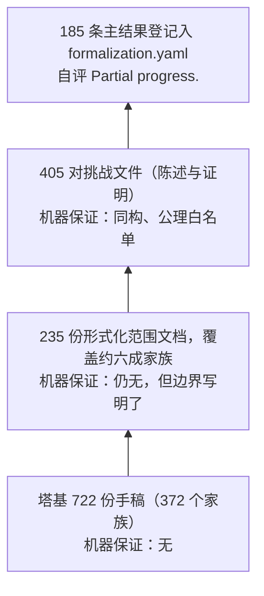
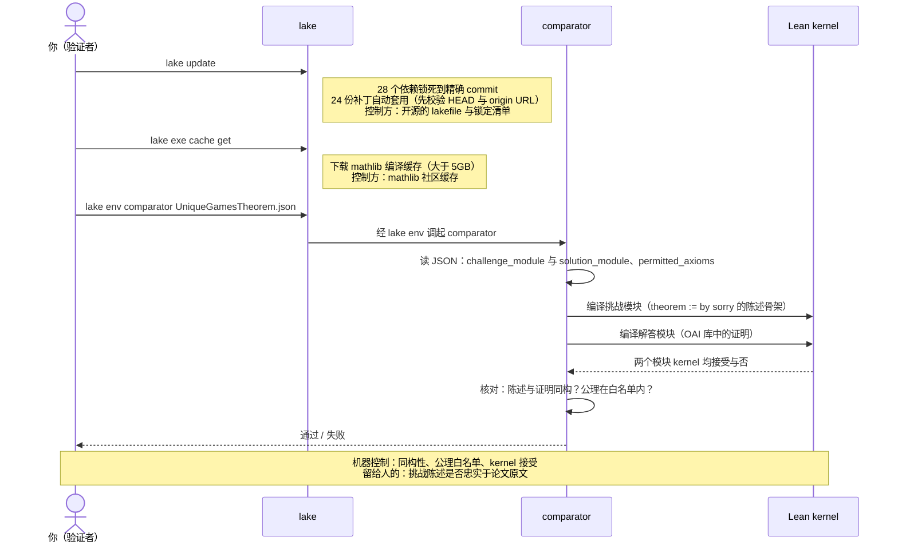
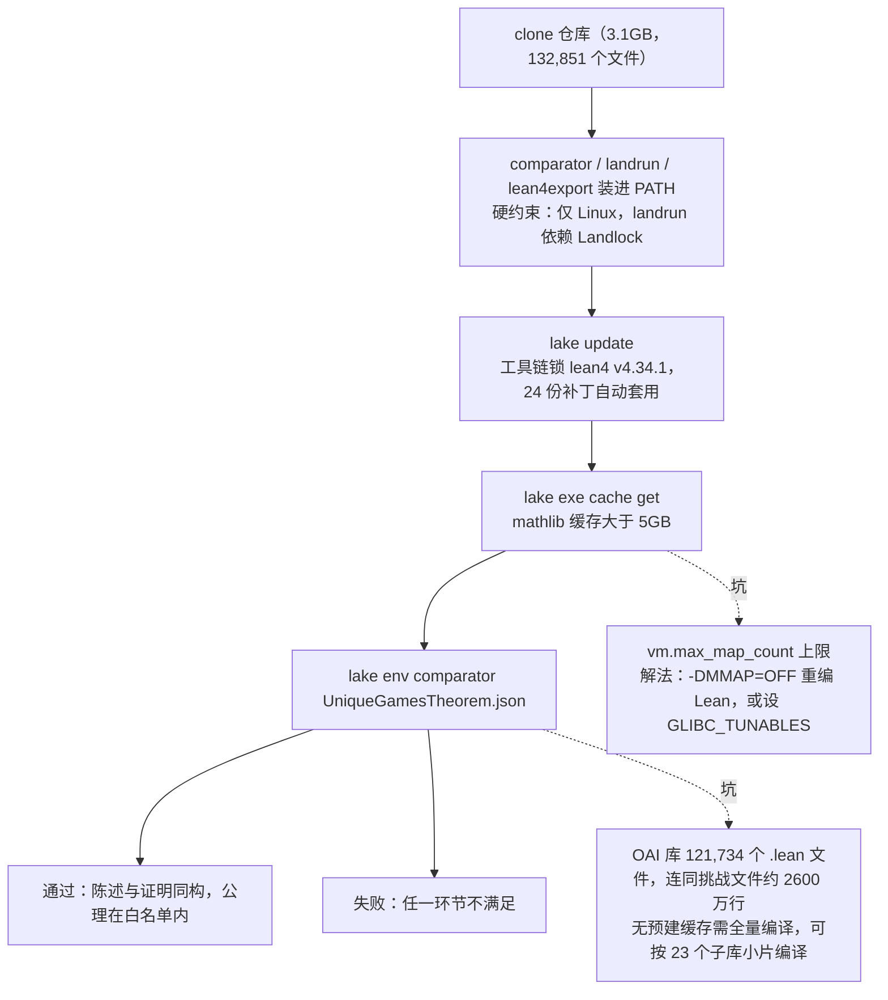
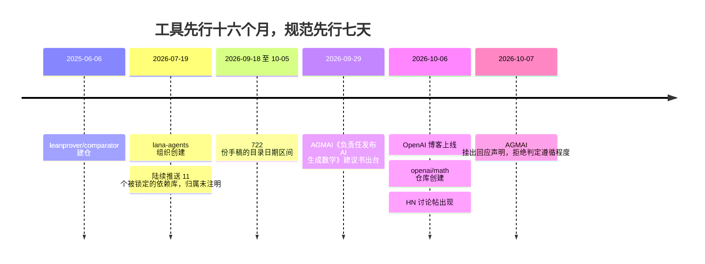

# 从「相信 OpenAI」到「跑一次 lake build」：拆解 openai/math 的三层信任结构

> 2026-10-08

2026 年 10 月 6 日 21:47（UTC），GitHub 上出现一个 3.1GB、132,851 个文件、只有一个 commit 的仓库：openai/math。唯一的一次提交叫 adc7f12，提交信息就一句 "Initial commit"。它的 README 第 7 到 9 行写着一句在 AI 实验室发布文里极其罕见的话——"Some of the unformalized results could have issues"：我们发布的 722 份数学手稿里，没做形式化的那部分可能有错。

这句自我坦白把一个问题摆到每个读者面前：面对 AI 产出的数学证明，你到底在信什么、能信到哪一层？这个仓库把答案做成了显式的分层结构，一共三层，每层要你信的东西不一样：塔基的手稿大多没有机器证书，只能信 OpenAI；中间的形式化产物，信的是一个叫 comparator 的开源社区工具；塔尖那部分能亲手验证，只要你的 Linux 机器跑一条命令。本文就从塔基走到塔尖。走完你会知道哪 162 篇论文有机器可查的形式化映射（仓库自报「部分进度」）、哪 560 来份手稿目前只能凭信任、那条命令跑下去时你的电脑实际在检查什么，以及哪一步机器永远替你检查不了。

## 一份自我坦白的 README，和一座验证金字塔

README 那段话值得引完整：

> This collection includes results at different stages of verification. Not all have accompanying Lean formalizations. ... Some of the unformalized results could have issues. We will endeavor to fix any such issues quickly.

发布者给这个仓库的定位是「不同验证阶段的结果集合」，不是「722 个已证明的定理」。这不是免责声明的姿态，它对应着一组能逐层数出来的结构，我把它叫作验证金字塔。

数字都是拿 find 和 grep 在本地克隆上数出来的。塔基是 722 份手稿，同一问题的几份归作一家，共 372 个「结果家族」；目录名自带日期，从 2026-09-18 一路排到 10-05，十八天出齐，平均每天四十份左右的节奏。

往上的三级都在 lean/ 工程里。235 份形式化范围文档（lean/docs/ 下每篇一份），每份讲清「这篇论文的哪些部分被形式化了、哪些没有」，覆盖约六成家族。再往上 405 对挑战文件，每对由一份「陈述」和一份「证明」组成，这是机器真正可查的一层，下一节专门拆开讲。塔尖是 formalization.yaml 登记的 185 条主结果，对应 162 篇论文，OpenAI 给这一层的自评是 "Partial progress."（部分进度）。

这座金字塔画出来是这样：



账本有四级，信任只换两次手：塔基全凭信 OpenAI；到了挑战文件这一级，核对交给 comparator，信任对象换成社区工具；爬到塔尖，只剩你的机器和一条命令说了算。中间那 235 份范围文档不换信任对象，只把「形式化到哪为止」写明白——账本因此四级，信任因此三层。反过来看更清楚：722 份手稿里约 560 份没有任何 Lean 证书，这个仓库的大多数内容，目前只靠那句「可能有错」的承诺托底。

赌注为什么配得上一座金字塔？挑最重的一块说。preprints/The-Unique-Games-Theorem-September-23-2026，58 页，论文自述正面解决 Unique Games 猜想——对每个 ε, δ ∈ (0, 1/2)，存在从 3SAT 到显式平移 Unique Games 实例的确定性多项式时间间隙归约。这个陈述若站得住，docs/102.md 列出的一串既有归约同时补全了前提：Max-Cut 超越 Goemans–Williamson 近似比、Vertex Cover 的因子 2 界、Min-UnCut、有向反馈顶点集。理论计算机科学里挂在 UGC 名下的整面墙，一次性从「猜想的推论」变成「定理的推论」。

所以我的判断是：这不是「AI 解决了数学」的仓库，而是把可信度本身当工程来做的产物，连没验证到的部分都标了价。信任在这里不是开关，是分层。后面几节按层拆：验证工程层（comparator 机制与亲手实操）、映射层（formalization.yaml）、数据层（推理轨迹）、方法论层（与 AlphaProof 的对照）。

## comparator：把『定理说什么』和『定理对不对』拆开

全文技术密度最高的一节，得放慢讲。

先看数据结构。405 份挑战文件不是 405 份证明，而是 405 对。每份 ComparatorChallenges/X.json 声明两个模块：challenge_module 指向陈述方的 .lean 文件，里面是 theorem ... := by sorry——一个故意的洞，陈述在此、证明缺席；solution_module 指向 OAI 库里的证明方模块。外加 theorem_names、permitted_axioms、enable_nanoda 几个字段。以 UniqueGamesTheorem.json 为例，它指向 OAI.UniqueGamesTheorem.theorem11。这 405 份 JSON 我做过全量结构审计（脚本跑全量，不是抽样）：全部合法，挑战与解答两侧的模块文件全部存在；404 份含 sorry，唯一的例外是 HarmonicGrowth.lean，用 axiom 占了位。

成对设计完成的是一次概念上的外科手术：把「定理说什么」（挑战侧）与「定理对不对」（解答侧）拆成两个独立文件，机器分头核对。

裁判随后登场，而它不是 OpenAI 的东西。leanprover/comparator 是 2025 年 6 月 6 日建仓的社区工具，比这次发布早十六个月，自我定位是 "a trustworthy judge for Lean proofs"。它保证三件事：解答定理与挑战陈述同构——不是名字相同，是逻辑上同一个命题；公理不超出白名单；Lean kernel 接受整个证明。它的 README 把信任假设一条条摆在明处：挑战文件的导入闭包与 lakefile 由验证者控制、landrun 沙箱（Linux 内核自带的 Landlock 机制）无漏洞、kernel 正确、以非特权用户运行。每一条都还能继续削减——「kernel 正确」可以用 lean4export 把证明导出成 NDJSON 交给另一个独立内核复检，把「信这一个 kernel」降级成「至少一个 kernel 是对的」。它甚至披露 landrun 自身有已知漏洞（"will be fixed in Linux 7.1"），建议用 systemd-run 兜底。把自家工具的漏洞写进 README 的验证器，比宣称万无一失的验证器可信。

审计里最干净的一项是三公理纪律：405 份文件、合计 507 条定理引用，全部且仅使用 Lean 的三条标准公理 propext、Quot.sound、Classical.choice。缺口也有，同样写在明处——9 份 JSON 含 definition_names 定义洞（Brenier、KServer、Naimark 等），也就是陈述里引用的定义不由 comparator 核对；它的 README 自己承认定义洞可被 gaming，"must always be checked with an additional (potentially human) verifier"。

一次完整验证的时序与控制边界，画成图：



图里的分工要看清楚：同构、公理、kernel 接受全部落在机器手里，唯一留给人的环节是最左边那个——读论文、对陈述。

合起来看，这套设计没有消灭信任，而是把信任面切到最小、逐项标价。跑完一次 comparator，你不必再信 OpenAI 的证明能力，剩下的信任只有三条：(a) Lean kernel 正确，可双内核互查；(b) comparator 与沙箱无洞，开源可审、已知漏洞有披露；(c) 挑战陈述忠实于论文，机器帮不了，只能人工拿着 docs/102.md 一行行对照。残余的 (c) 恰是社区争论的焦点，这里先把机制点破，争论留到结尾。

## 亲手验证一条定理：从 clone 到 lake build 会发生什么

想亲手跑一遍，先看你拿到的是什么。lean/ 目录是完整可复现的 Lake 工程，不是象征性的代码摘录。三个细节能说明认真程度：lean-toolchain 把 Lean 锁死在 leanprover/lean4:v4.34.1（fixedToolchain := true）；lakefile.lean 把 28 个第三方依赖全部锁到精确 commit——mathlib4@d13f23b7、harfe/fixed-point-theorems、math-inc/strongpnt，再加挂在 lana-agents 组织下的 11 个库——lake-manifest 里共 42 个包；24 份 patches/*-lean4341.patch 由 lakefile 内嵌的状态机（absent / applied / needsApply 三态，先校验 HEAD commit 与 origin URL 再 apply）在你跑 lake update 时自动套上。供应链级的依赖锁定，正是「跑一次 lake build 而不是信一次 OpenAI」的工程前提：你编译的每个字节都有出处。

操作本身不复杂，官方路径（lean/ComparatorChallenges/README.md）三步：

```bash
# 前提：comparator、landrun、lean4export 装进 PATH；仅限 Linux
lake update && lake exe cache get
lake env comparator ComparatorChallenges/UniqueGamesTheorem.json
```

README 原例是 QuasiRiemannHypothesis.json，验证 UGC 换个名字就行。lake update 拉依赖、套补丁；lake exe cache get 下载 mathlib 编译缓存；comparator 读 JSON，分别编译陈述方与证明方，交给 kernel 核对。通过就是通过，失败就是失败，没有酌情空间。

整条路走下来是这样的：



磁盘和时间的预算说在前面。mathlib 的 olean 缓存一项就超过 5GB；OAI 自建库没有预建缓存，121,734 个 .lean 文件要现场编译，连同 405 份挑战文件合计约 2600 万行（库被拆成 23 个学科子库，正是为了让你能小片编译）。还有一个官方明示的坑：整库编译可能触发 Linux 的 vm.max_map_count 上限，出路要么以 -DMMAP=OFF 重编 Lean，要么设 GLIBC_TUNABLES=glibc.malloc.mmap_max=0:glibc.malloc.arena_max=1。这是一桩会吃满磁盘和 CPU 的活，不是挂着等通知的后台任务。

两件事必须如实交代。其一，本文引用的调研在一台 macOS、16GB 内存、只剩 5GB 空闲磁盘的机器上完成，完整 build 没跑成，这是未跑项，不装；替代做的是静态检查，即 405 份 JSON 的结构审计加全库 grep（OAI/ 目录下零 sorry、零自定义 axiom）。目录级审计不等于 Lean kernel 验证，这两件事必须分开说——分清它们，就是做验证的第一课。其二，供应链有个暗面：28 个锁死的依赖里，11 个挂在 2026 年 7 月 19 日才创建、归属未注明的 lana-agents 组织下，包括 IUT（望月新一的宇宙际 Teichmüller 理论）的形式化。如果这些是 OpenAI 形式化 agent 的产出库，「自定义 OAI 库」的边界比看上去大得多——你以为在依赖外部独立检查的库，可能全是一家 agent 的自产自销；若真是第三方，供应链信任面反而更宽。仓库对此没有任何说明，我把它标为未解争议，不替任何一方圆场。

到这一步可以说：「无需信任任何机构」不是修辞，而是一条确定性程序在你自己机器上的执行。但它的完整表述是——无需信任机构，只需信任工具链加陈述保真。省下的那部分信任，记在账上。

## formalization.yaml：每篇论文的机器保证边界在哪一行

从命令行退出来读文档。lean/formalization.yaml 这个文件，可能比库里任何一条定理都更该读。

它遵循 mathlib-initiative 的社区 schema（v0.4），结构是一条映射链：sources 登记 162 篇论文，各自指向 PDF 路径；status.main_results 收录 185 条三元组——comparator_config、declaration、file，即「哪份挑战文件里的哪个定理名，在哪个库文件里」；automation.methods 填 [agent]，明说形式化由 agent 完成；review.status 填 unchecked，人工评审没做。这两个字段并排出现，本身就是一句坦白：机器保证和人读过，是两件事，OpenAI 自己知道。

235 份 docs/NNN.md 是这条映射链的人类可读版，也是我见过最诚实的范围声明。docs/003.md 对应 Riemann zeta 那篇，明写论文的后继应用不在形式化范围内、常数 c 无显式给出、不排除 (0,1) 内别处还有实零点；形式化覆盖的是 Re > 7/8 主结果加 Siegel 零点一致排除，论文里 Re > 11/12 的另一条路线不在范围内。docs/102.md 对应 UGC，一句 "No assumption that P≠NP is built into the statement"——陈述里没有内置 P≠NP。这种话不读原文是编不出来的。

所以形式化在这里做的不是「翻译」——翻译隐含忠实——而是为每篇论文显式划线：机器保证到哪一行为止。

KMS 案例把「陈述保真」投影到了库内部。UGC 论文把 KMS23 展开定理列为 external input，即沿用人类已证定理；但 OAI 库里的 kms_expansion（KMSAnalyticHybridEnergyLemmas.lean:337）是自己证的，零 sorry 零公理。它的陈述 KMS.ExpansionPrinciple（KMSFoundationLemmas.lean:109）是全量词的 Grassmann 展开命题，注释专门强调量词顺序的接口约束——"A bound with alpha = 2^{-ell} does not meet this interface"。同一个库里，KMSDimensionOne.lean 自我声明只证了一维受限情形，"does not imply the OPEN large-dimension KMS principle"。作者对「形式化陈述的强度与论文声明是什么关系」显然有自觉。但问题没有消失：库内自证的展开原理，和论文当 external input 引用的 KMS23，强度一致吗？仓库没有给出对照表，这个问题我答不了，原样留在这里。

## reasoning_traces：漏斗的分母比分子更有信息量

前几层都在问「结果对不对」，reasoning_traces/ 里的 10 份文档补上账本的另一半：这些结果怎么被造出来。

形态先说清，免得期待错位。10 份轨迹对应十个家族——007、017、087、102、159、197、221、271、287、362——覆盖 Chowla 二点相关、π 的无理度指数等于 2、Mahler 猜想、Mézard–Parisi 公式、自由群因子同构、三维相对论 Vlasov–Maxwell 大数据整体解等。每份由三块组成：『Original prompt (excerpts)』、按主题分节的思考路径叙述、真实的参考文献。留意 excerpts 这个词，原始 prompt 只给了节选。

出题的原文不妨整段引（mezard-parisi-formula.tex）："Even if the problem is \"open\", the intention is that you should resolve it and present a full solution"；还有一句 "Brute-force enumerations and computer-assisted proofs are strongly discouraged"。两句话规定了结果的形态：不许绕开，不许暴力。在讨论「AI 的创造力」之前，先看问题本身被措辞成了什么样。

失败路径被如实保留，是这批材料里最难得的部分。π 那份 42 页的轨迹记着 "Derivative denominators defeated this" 这样的死路，还写明两个部分的关系：Part I 声明了 62/25 的界，Part II "explicitly without assuming the earlier approximation bound"——第二部分明确不依赖第一部分那个近似界。

漏斗的分母在 README 第 41 到 43 行：约 4000 个问题投进去，产出 722 份手稿、372 个家族（722/4000 ≈ 18%，372/4000 ≈ 9%）；平均每个结果消耗三小时 ChatGPT Pro 级的思考算力。zeta 零点自由区域和 CM 代数簇上的 Hodge 猜想两块工作走了非标准流程。「三小时 ChatGPT Pro」这个口径在 HN 上被用户 orlp 批评为 DeepMind 式的模糊——他要的是 Blackwell GPU-hours 或 kWh——第六节回收这个话头。

对这批数据的价值要做减法。README 自称 abridged summaries：不是原始 token 流，没有逐 token 观测，直接当 RL 或蒸馏数据的说法要打折扣；更有用的是十个「开放问题如何被拆解」的领域方法论样本，死路也包括在内。OpenAI 博客称之为 "resource for the research community"，但没有承诺发布原始轨迹。「开放推理轨迹」这个标题下，开放的是摘要，不是数据。

顺带一个可信度小注脚：README 的表把家族 102 标为 "Ordinary NP-hardness at the basic semidefinite threshold"，与该轨迹 PDF 页眉的 "BasicSDP threshold and Unique Games" 同指一个侧面；而 CONTENTS.md 和 overview 里的家族 102 是 UGC 本尊。同一个编号，两个侧面，README 没说清。小处，记下无妨。

## 与 AlphaProof 殊途同归的终点，和独自掉队的部分

先给结论：两条路线几乎在所有维度上相反，唯独验证纪律收敛到同一处。

| 维度 | AlphaProof（Hubert et al., Nature 645） | openai/math |
| --- | --- | --- |
| 证明在哪发生 | Lean 内 AlphaZero 式 AND-OR 树搜索 RL | 未发布内部 LLM 的自然语言长思考在先，形式化是 agent 事后工序 |
| 模型与训练 | 3B 编码器-解码器；预训练 300B token；SFT 约 30 万 Mathlib state-tactic 对 | 模型名未公开（"unreleased internal model"） |
| 题目 | 封闭题库的竞赛题；IMO 2024 解 3 题，银牌 28/42 | 开放研究问题；约 4000 题筛成 722 份手稿 |
| 算力披露 | 主 RL 约 80,000 TPU-days；autoformalization 约 100,000 TPU-days | 「平均 3 小时 ChatGPT Pro 思考」 |

orlp 的批评放进表里就清楚了：一边是 TPU-days，一边是「ChatGPT Pro 小时」。后者换算不了、复核不了，也讨论不了边际成本——算力口径决定别人能否评估这件事的可复制性。

收敛的那一点更要紧。AlphaProof 收尾用标准 lean 命令行加三标准公理检查；openai/math 的 405 份挑战文件，permitted_axioms 白名单与之完全一致：propext、Quot.sound、Classical.choice。「三公理纪律」正在成为 AI 证明的事实标准。从长远看，这可能比仓库里任何一条具体定理都更是这次发布的历史遗产。

把发布前后的时点排开，能看到一种整齐的错位：



验证工具先行了十六个月，行为规范只先行了七天。工程层来得及做的事——依赖锁定、挑战文件、形式化映射——都做了；社区关系层的事，还没见落地。

掉队的是版本化承诺。README 第 46 到 50 行白纸黑字：保留发布历史，修正记为新版本，旧版本保持可访问。现实（GitHub API 查的）是：无 git tag，无 Release，issues 功能关闭（has_issues = false），无描述无主页；AGMAI 建议的社区托管仓库，还停在 README 第 10 行的 "exploring"。纠错通道只剩等 commit 推送。社区早有预测，未形式化的手稿里会有错被揪出来，mathisfun123 的原话是 "one of these is wrong"。揪出来之后往哪报？仓库没说。

## 跑命令的人，和读陈述的人

HN 帖 49984923，1137 分、1229 条评论（调研笔记经 Algolia API 拉取了全量），差不多是关心形式化验证的人的一次站队。三句话足以代表三个位置。mathisfun123 属陈述保真度派："good luck doing that across such a broad swath of problems"——要对这么广的一批问题逐个把陈述写对，祝你好运。fspeech 引 Thomas Hales："often the problem is the statement not the proof"——通常出问题的不是证明，是陈述。margorczynski 站另一头："a Lean proof is a much stronger guarantee than anything that can be provided by any human"——Lean 证明比任何人类能提供的保证都强。

两边说的其实不是同一件事，而仓库的结构恰好把两件事都摆了出来。再拿 AGMAI 的建议书逐条对照（agmai.org/general-sep29/，2026-09-29，Gowers、Hairer、Witten 等九人署名，源自 600 多份数学界问卷）：comparator 挑战文件，✓；formalization.yaml，✓，用的就是社区 schema；总结式推理轨迹，部分 ✓；4000 题分母披露，✓——验证工程层恰好是建议书里被实现得最好的部分。但模型名 ✗（"unreleased internal model"）；原始 prompt 仅节选；社区托管 ✗（"exploring"）；而发布方式本身，正是 AGMAI 开头就反对的 practice——"we ask them to stop testing advanced mathematical problems on proprietary models"。AGMAI 自己在 10 月 7 日的回应里也拒绝判定遵循程度："ultimately up to the mathematical community to assess"。

机器可验证性正是对这种不信任的工程回应，但它只回应了一半：它把「证明对不对」的成本压到一条 lake build，却把「定理说的是不是你以为的那件事」的成本原封不动留给了人类阅读。

当验证证明趋近免费，稀缺的劳动移到了验证陈述。对塔基那约 560 份手稿，仓库的全部答案是 README 那句「可能有错、尽快修」，外加一个关着 issues 的仓库；对 185 条已形式化主结果的陈述保真，答案才是 235 份等人来读的 docs/ 文档。如果 AI 能把 4000 个开放问题筛成 722 份手稿，谁来把 722 个「定理说的是不是你以为的事」逐个核对一遍？这份劳动没有工具、没有署名激励、也最难自动化。这条验证之路最终指向的，不是跑命令的人，而是读陈述的人。
